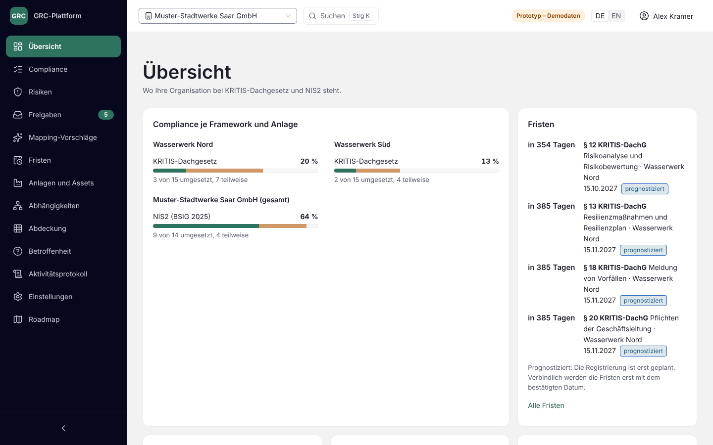

# GRC Platform: KRITIS-Dachgesetz

A multi-tenant governance, risk and compliance SaaS for operators of critical facilities in Germany. It covers the KRITIS-Dachgesetz (physical resilience) and maps it to NIS2 as implemented in the BSIG, so one piece of work counts toward both.

> **Status:** the clickable prototype on demo data is complete; the backend milestone M0 is in progress (see [docs/scope.md](docs/scope.md)). The prototype will be live at **grc.inomov.online**, marked "Prototyp – Demodaten"; the deployment is pending.



## A short tour of the prototype

Everything runs in the browser on fictional data; nothing is sent anywhere. Sign in with "Als GRC-Manager ansehen", or as the Auditor, who reads everything and changes nothing.

1. **Übersicht:** compliance per Framework and facility, the next legal deadlines, the residual risk matrix and your open Implementations.
2. **Compliance:** from paragraph to Requirement to Implementation. Set a status, attach Evidence, or refer to the BSIG Implementation that already covers it.
3. **Risiken:** inherent, residual and target ratings, and how each measure lowers a Risk.
4. **Mapping-Vorschläge** and **Freigaben:** review what the AI proposes, and approve Risk Assessments under the four-eyes rule.
5. **Fristen, Abhängigkeiten, Abdeckung:** the legal deadlines on a timeline, what each facility depends on up to its suppliers, and where one Implementation counts for KRITIS-DachG and BSIG at once.
6. **Betroffenheit:** whether the KRITIS-Dachgesetz applies to a facility, explained with its legal basis.

`Ctrl K` (`⌘ K` on a Mac) searches everything. Run locally with `pnpm dev`, a "Simulation" panel also slows the mock API down, makes it fail, or takes the risk engine offline, so the loading, error and "calculation pending" states can be seen too.

## Where to start

| You want to… | Read |
|---|---|
| Understand the domain language | [GLOSSARY.md](GLOSSARY.md) |
| See what is built, and when | [docs/scope.md](docs/scope.md) |
| Understand why it is built this way | [docs/adr/](docs/adr/README.md) |
| Follow the day-to-day rules | [docs/conventions.md](docs/conventions.md) |
| Work on this repo with an AI assistant | [CLAUDE.md](CLAUDE.md) |
| Browse all documentation | [docs/README.md](docs/README.md) |

## Run locally

Requires Docker. Copy the example configuration and fill in random values:

```bash
cp .env.example .env
```

| Stack | Command | Open |
|---|---|---|
| Development (hot reload, Vite on the real API) | `docker compose up` | http://localhost:5173 |
| Production-like (gunicorn, nginx, TLS to Postgres, S3 storage) | `docker compose -f compose.prod.yaml up --build` | http://localhost:8081 |

The prototype on mock data needs only the frontend: see [frontend/README.md](frontend/README.md). Each service's own commands are in [backend/](backend/README.md), [services/risk-engine/](services/risk-engine/README.md) and [frontend/](frontend/README.md).

## License

Proprietary. All rights reserved. The source is visible for evaluation only. See [LICENSE](LICENSE). Security issues: see [.github/SECURITY.md](.github/SECURITY.md).
