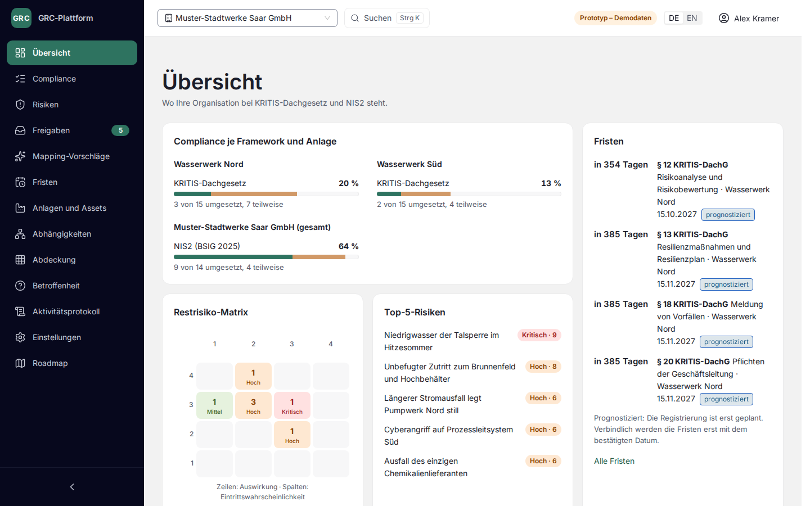
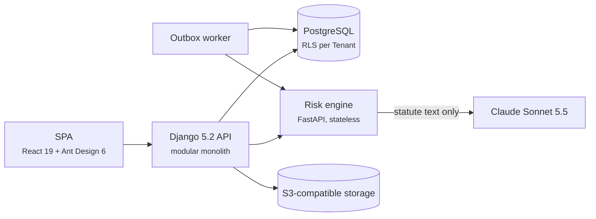

# GRC Platform: KRITIS-Dachgesetz

[](https://github.com/farrukhinomov/kritis-grc/actions/workflows/ci.yml)
[](https://github.com/farrukhinomov/kritis-grc/actions/workflows/codeql.yml)

A multi-tenant governance, risk and compliance SaaS for operators of critical facilities in Germany. It covers the KRITIS-Dachgesetz (physical resilience) and maps it to NIS2 as implemented in the BSIG, so one piece of work counts toward both.

## Why KRITIS-Dachgesetz, and why now

The KRITIS-Dachgesetz has been in force since 17 March 2026; the BSIG implementing NIS2 since 6 December 2025. A waterworks, a power plant or a hospital now owes two regulators a risk analysis, resilience measures, incident reports and proof of all of it, under two laws that overlap but don't match. Their deadlines start with the facility's Registration, which waits for the thresholds ordinance: operators have a few months to prepare and no tool built for the new law. This platform does the comparison once, keeps the work in one place, and shows which deadline comes next.

## Live demo

**[grc.inomov.online](https://grc.inomov.online)** opens the fictional "Muster-Stadtwerke Saar GmbH" as its GRC Manager. To see the Auditor, who reads everything and changes nothing, sign out and choose "Als Auditor ansehen". All data is fictional and reset every night.



The story in five steps: open the KRITIS-DachG cockpit for "Wasserwerk Nord", whose deadlines are projected from its planned Registration; attach Reference Evidence that points to the existing NIS2 Implementation; set the Implementation to "implemented" and watch its Risk move on the matrix; then sign in as the Auditor and find every change in the Activity Log.

## Architecture



Context, container and event-flow diagrams: [docs/architecture.md](docs/architecture.md).

## Key decisions

| Decision | Why | ADR |
|---|---|---|
| Tenant isolation in the ORM **and** Postgres row-level security | A forgotten filter or a raw query can't show one Tenant's data to another | [0006](docs/adr/0006-shared-schema-tenant-isolation.md), [0022](docs/adr/0022-postgres-rls-defense-in-depth.md) |
| Django owns all data; the FastAPI risk engine is stateless | One ORM, one set of migrations, no second path to the database | [0001](docs/adr/0001-django-owns-all-data-fastapi-is-stateless.md) |
| Domain events through a transactional outbox in Postgres | Reactions survive a dependency being down, without a message broker | [0011](docs/adr/0011-transactional-outbox-in-postgres.md) |
| An immutable Activity Log written by database triggers | No code path can change data without leaving a trace | [0009](docs/adr/0009-activity-log-immutable-in-database.md) |
| A fixed, versioned 4×4 qualitative risk method | Ratings judged by the effect on people, reproducible after the method changes | [0014](docs/adr/0014-qualitative-versioned-risk-method.md) |
| The LLM sees only public statute text | No tenant data leaves the EU, whoever runs the model | [0007](docs/adr/0007-llm-sees-only-public-requirement-text.md) |
| Authorization in the service layer | No entry point (API, token, job) can skip a permission check | [0020](docs/adr/0020-authorization-in-the-service-layer.md) |
| Portable to sovereign hosting | No cloud SDK outside adapters; the whole stack runs from `docker compose` | [0021](docs/adr/0021-portable-to-sovereign-hosting.md) |

All 22 decisions: [docs/adr/](docs/adr/README.md).

## AI: Mapping Suggestions and how they are measured

Claude Sonnet 5.5 compares each KRITIS-DachG Requirement with every BSIG Requirement and proposes Mappings with a coverage level, a confidence and a rationale in German and English. It only ever sees the statute text. A GRC Manager approves or rejects each proposal; nothing changes until a person decides. Answers naming a provision that wasn't offered are dropped, refusals and cut-off answers are never used, and each Tenant has a daily cap on model calls.

The eval in [`services/risk-engine/evals/`](services/risk-engine/evals/) measures the production prompt against a gold set: the curated Platform Mappings as positives and known non-overlaps as negatives. It reports recall, precision over labelled pairs and coverage agreement over several runs, with the cost of the run. Pairs in neither list are set aside for review, never counted as wrong. It runs when the prompt or the gold set changes.

**Latest results:** not run yet. The first run needs an API key; its numbers will replace this line.

How AI was used to build the project, and where its suggestions were changed or rejected: [docs/ai-log.md](docs/ai-log.md).

## Run it

Requires Docker. Copy the example configuration and fill in random values (`ANTHROPIC_API_KEY` is optional; without it Mapping Suggestions say "unavailable"):

```bash
cp .env.example .env
docker compose up                                  # development, http://localhost:5173
docker compose -f compose.prod.yaml up --build     # production-like, http://localhost:8081
```

Both stacks load the Demo Tenant and offer the two demo logins. `docker compose run --rm backend python manage.py reset_demo` restores it; `… suggest_mappings muster-stadtwerke` asks the AI for new Mapping Suggestions.

The prototype on mock data needs only the frontend: see [frontend/README.md](frontend/README.md). Each service's own commands are in [backend/](backend/README.md), [services/risk-engine/](services/risk-engine/README.md) and [frontend/](frontend/README.md).

## Where to start

| You want to… | Read |
|---|---|
| Understand the domain language | [GLOSSARY.md](GLOSSARY.md) |
| See what is built, and when | [docs/scope.md](docs/scope.md) |
| Understand why it is built this way | [docs/adr/](docs/adr/README.md) |
| Follow the day-to-day rules | [docs/conventions.md](docs/conventions.md) |
| Work on this repo with an AI assistant | [CLAUDE.md](CLAUDE.md) |
| Browse all documentation | [docs/README.md](docs/README.md) |

## License

Proprietary. All rights reserved. The source is visible for evaluation only. See [LICENSE](LICENSE). Security issues: see [.github/SECURITY.md](.github/SECURITY.md).
