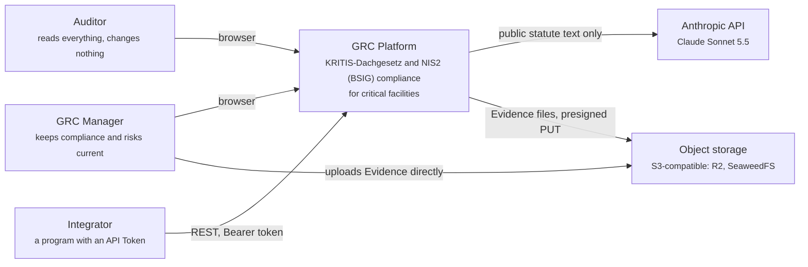
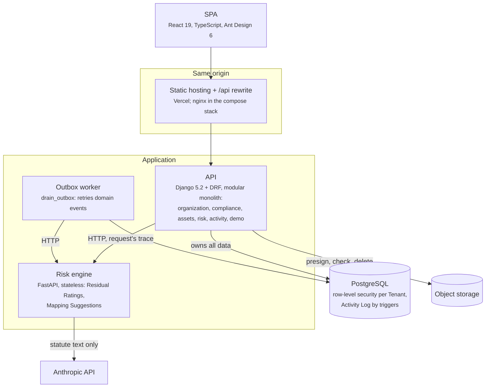

# Architecture

Three diagrams: who uses the platform and what it talks to (C4 context), what runs where (C4 container), and how a status change becomes a moved Risk (event flow). The decisions behind them are in the [ADRs](adr/README.md).

## Context



Only the text of public statutes leaves for the LLM; no Tenant, Scope or person does ([ADR 0007](adr/0007-llm-sees-only-public-requirement-text.md)). Files go from the browser straight to storage, never through the application.

## Containers



- **Django owns every table.** The FastAPI service never connects to Postgres; Django sends what it needs and stores the answer ([ADR 0001](adr/0001-django-owns-all-data-fastapi-is-stateless.md)).
- **Tenant isolation twice:** every query is filtered by the active Tenant in the ORM, and Postgres row-level security enforces the same Tenant per transaction ([ADR 0006](adr/0006-shared-schema-tenant-isolation.md), [ADR 0022](adr/0022-postgres-rls-defense-in-depth.md)).
- **Authorization lives in services**, which receive the actor, so no entry point can skip it ([ADR 0020](adr/0020-authorization-in-the-service-layer.md)).

## Event flow: from a status change to a moved Risk

```mermaid
sequenceDiagram
  autonumber
  actor M as GRC Manager
  participant API as Django API
  participant DB as PostgreSQL
  participant OB as Outbox
  participant RE as Risk engine

  M->>API: PATCH implementation (If-Match: version)
  API->>DB: BEGIN; update Implementation (Activity Log row by trigger)
  API->>DB: insert ImplementationStatusChanged + one delivery per handler
  API->>DB: COMMIT
  API-->>M: 200 with the new version
  Note over API,OB: right after the commit, still in the request
  OB->>DB: claim delivery (FOR UPDATE SKIP LOCKED), as the event's Tenant
  OB->>DB: lock the treated Risks, read current statuses
  OB->>RE: POST /v1/risk-scores:batch
  RE-->>OB: Residual Ratings + method_version
  OB->>DB: store changed ratings, mark delivered, COMMIT
  alt the engine is down
    OB->>DB: attempts + 1, next try with backoff; the Risk shows "pending"
    Note over OB: drain_outbox retries until delivered or dead
  end
  M->>API: GET risk-matrix
  API-->>M: the Risk in its new cell
```

The change and its event commit together, so no reaction is lost when the engine is down ([ADR 0011](adr/0011-transactional-outbox-in-postgres.md)). The handler re-reads the current state instead of trusting the event, so a retry or a late delivery gives the same result. Every rating carries the method version that produced it ([ADR 0014](adr/0014-qualitative-versioned-risk-method.md)).
