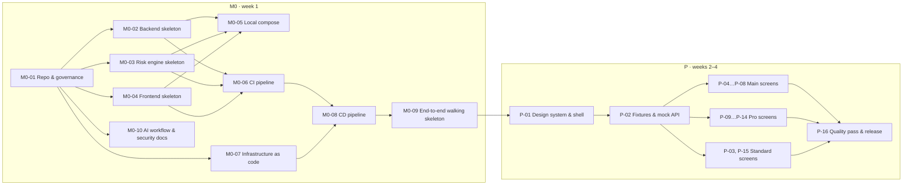

# Implementation plan: M0 and P

Covers weeks 1–4 of [scope.md](../scope.md): **M0 Walking skeleton** (week 1) and **P Prototype** (weeks 2–4). The application goes out after P. The issues themselves are in [backlog-m0-p.md](backlog-m0-p.md), written so they can be copied into GitHub Issues one to one once the repository exists.

## Approach

1. **Burn down infrastructure risk first.** M0 ends with one request travelling through every layer in the demo environment: Vercel → Django → FastAPI → Supabase → R2. If a platform doesn't work as expected, we find out in week 1, not week 5.
2. **Build the pipeline before the features.** CI/CD, scanners, license check and branch protection exist before the first feature PR. Every later PR then pays the quality bar from the start.
3. **The prototype is the real frontend.** P builds on the M0 frontend skeleton, runs on MSW mocks shaped exactly like the planned API (tenant in the path, Problem Details, the list shape), and uses the shared `seed/` fixtures. M1 replaces the mocks endpoint by endpoint.
4. **Design system before screens.** Tokens, Themes, motion, `AnimatedIcon` and the app shell come first, so every screen is consistent and mobile-ready from its first commit.
5. **Thin vertical slices.** Each issue is one PR that leaves `main` deployable.

## Sequence

## Definition of Done (every issue)

- Acceptance criteria are met, and the PR links the issue.
- Tests are written first for behavior. Coverage stays ≥ 80 %, and all CI checks are green.
- UI work is checked at desktop and 390 px, in light and dark, with keyboard navigation and reduced motion.
- New UI strings are in German and English.
- Comments explain decisions in their own words, without links to docs.
- GLOSSARY, conventions or ADRs are updated in the same PR if the change touches them.
- Significant AI suggestions that were rejected are noted in `docs/ai-log.md`.

## Budget

20 h/week over 7 weeks. M0 and P together are estimated at **about 73.5 h** (M0 about 26.5 h, P about 47 h), against 80 h for weeks 1–4. M0 is planned for week 1 and spills about 6.5 h into week 2. P runs over weeks 2–4, and the application goes out after P. M1–M3 follow in weeks 5–7.

## Risks

| Risk | Mitigation |
|---|---|
| WIF / Cloud Run / Vercel rewrite setup eats the week | M0-07/08 come before any feature work. Fallback: deploy manually once and automate in week 2 |
| pghistory context or RLS under Supavisor behaves unexpectedly | Covered in M1, but M0-09 already checks transaction-local `set_config` through the pooler |
| Mobile polish for 11 screens takes longer than estimated | Patterns (stacked screens, bottom sheet, card list) are built once in P-01 and reused |
