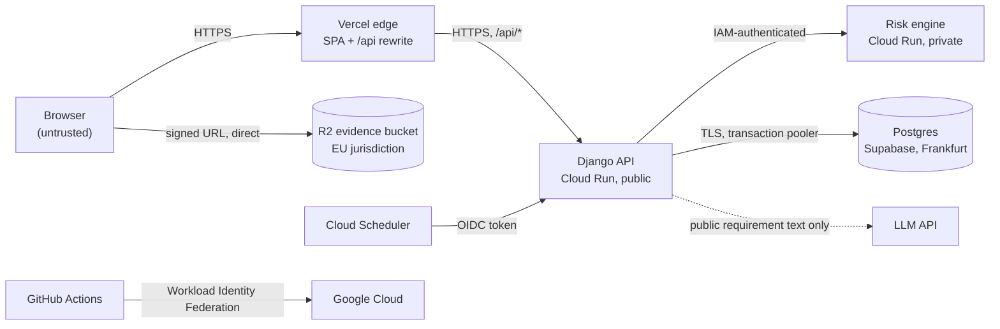

# Threat model (v0)

STRIDE-lite model of the public demo and of the product it represents. Every threat lists its mitigation and the test or check that proves it. "Planned" means the mitigation is designed (see the linked decision) but its code arrives in a later milestone. Revisit this document at every milestone.

*Version 0, 2026-10-25. Scope: M0 walking skeleton plus the designed v1.*

## System and trust boundaries

| Boundary | What crosses it | Who is trusted |
|---|---|---|
| Browser → edge → API | Every request, cookies, uploads metadata | Nobody: authenticated and authorized per request |
| API → database | All tenant data | The API's app role only (no ownership, no `BYPASSRLS`) |
| API → risk engine | Ratings and Treatments, no personal data | The API's service account only (IAM) |
| Browser → R2 | File Evidence bytes | Whoever holds a signed URL, for about 5 minutes |
| API → LLM | Public statute text only | Third party outside the EU, so it never receives tenant data |
| GitHub → Google Cloud | Deployments | Workflows on `main` of this repository only |

## Assets

Tenant compliance data (Implementations, Evidence, Risks), File Evidence, the Activity Log, user accounts and sessions, API Tokens, secrets (database URLs, Django key, storage and LLM keys), the deployment pipeline, and the cloud budget.

## Threats

| # | Threat (STRIDE) | Mitigation | Proof | Status |
|---|---|---|---|---|
| T1 | A user reads another Tenant's data, e.g. through a missing filter or raw SQL (**I**) | Tenant in every URL; queryset layer filters by Membership and Scope; Postgres RLS as a second layer; 404 instead of 403 | Authorization matrix test; RLS raw-SQL test | Planned M1 |
| T2 | The edge cache serves one user's API response to another (**I**) | `Cache-Control: private, no-store` on every non-public `/api` response; the edge's rewrite caching switched off | `test_cache_control.py`; two-user E2E test | Header done; E2E planned M0-09 |
| T3 | Brute-forcing logins or API Tokens (**S**) | allauth rate limits; Argon2; API Tokens stored as hashes with expiry; TOTP for Platform Admins | Auth tests | Planned M1 |
| T4 | CSRF on session-authenticated writes (**T**) | Single origin; Django CSRF; `SameSite=Lax`, `Secure` and `HttpOnly` cookies; API Tokens exempt only because they aren't cookies | `check --deploy` test; CSRF tests | Settings done; tests planned M1 |
| T5 | XSS through stored content (**T**, **E**) | React escapes output; no `dangerouslySetInnerHTML`; CSP `script-src 'self'` | ESLint; header checks in the stack smoke test | Done |
| T5a | Inline styles allowed by CSP (**T**) | **Accepted risk.** `style-src 'unsafe-inline'` is needed by Ant Design's runtime styles, and a static SPA can't add per-request nonces. Scripts stay same-origin only, which blocks script injection | Revisit if the UI library supports nonces on static hosting | Accepted |
| T6 | Malicious or oversized uploads (**T**, **D**) | Direct-to-storage signed URLs; 20 MB and type allow-list checked when the URL is issued and again on confirm; downloads forced to `attachment`, never rendered inline; nightly wipe of demo uploads | Upload tests | Planned M1 |
| T7 | Abuse of the public writable demo: spam, defacement (**T**) | Demo Tenant reset every night; demo accounts can't change password, email or MFA; rate limits on writes | Reset job test | Planned M3 |
| T8 | Running up LLM costs (**D**) | Daily call cap; suggestions only on request; requests bounded in size | Cap test | Planned M3 |
| T9 | Prompt injection through requirement text (**T**) | Only curated public statute text is sent; output must cite given candidates, and anything else is discarded; every suggestion needs a GRC Manager's approval | Output-validation tests; gold-set evaluation | Planned M3 |
| T10 | Tenant data leaving the EU (**I**) | Frankfurt regions everywhere; R2 EU jurisdiction; the LLM never sees tenant data; region validation in OpenTofu | `tofu validate` with region rule | Done (infra) |
| T11 | Secrets in code, logs or state (**I**) | Secrets only in Secret Manager or a git-ignored `.env`; configuration errors name variables but never values; secret values never pass through OpenTofu; gitleaks over the full history | `test_settings.py`; gitleaks in CI | Done |
| T12 | Personal data or tokens in logs (**I**) | Paths without query strings; the request object is dropped before logging; no tenant data in operational logs | `test_log_filters.py`; access-log tests | Done |
| T13 | Activity Log tampering (**R**) | Postgres trigger rejects `UPDATE`/`DELETE`; only the demo reset may purge, through a per-transaction flag | Trigger tests | Planned M1 |
| T14 | A compromised dependency or CI action (**T**, **E**) | Lockfiles; actions pinned to SHAs; scanners as digest-pinned containers; Dependabot with a 7-day cooldown; osv-scanner and Trivy blocking high/critical; license policy | CI jobs | Done |
| T15 | Deployment pipeline takeover (**E**) | Workload Identity Federation limited to this repository and to `main`; no service account keys; least-privilege workflow permissions; `zizmor` audit | `zizmor` in auditor mode; OpenTofu review | Done (code); applied with M0-07 |
| T16 | Risk engine called directly by an attacker (**S**) | Cloud Run IAM: only the API's service account may invoke it; docs and schema closed in production | IAM binding in OpenTofu; risk-engine docs test | Done |
| T17 | Denial of service or traffic spikes (**D**) | **Accepted for the demo:** one instance per service caps cost, not availability. Rate limits per endpoint; Cloud Run's front end absorbs volumetric attacks | Budget alert | Accepted |
| T18 | Admin account takeover (**E**) | Admin under `/api/_admin/`, staff only, TOTP mandatory | Admin access tests | Planned M1 |
| T19 | Scope-limited user reaching another Scope (**E**) | Scope limits enforced in the same query layer as tenant isolation | Authorization matrix (Scope-limited actor) | Planned M1 |
| T20 | Container breakout or code tampering (**E**) | Non-root users; application code owned by root and read-only to the app; no `pip` in runtime images; OS patches at build | Trivy image scans; container smoke tests | Done |

## Open questions for the next revision

- Malware scanning of uploaded files: a free, self-hostable option, or "never rendered inline plus nightly wipe" as the accepted demo posture?
- Account lockout policy for real tenants beyond rate limiting.
- Incident response contacts and a security.txt once the domain is live.
